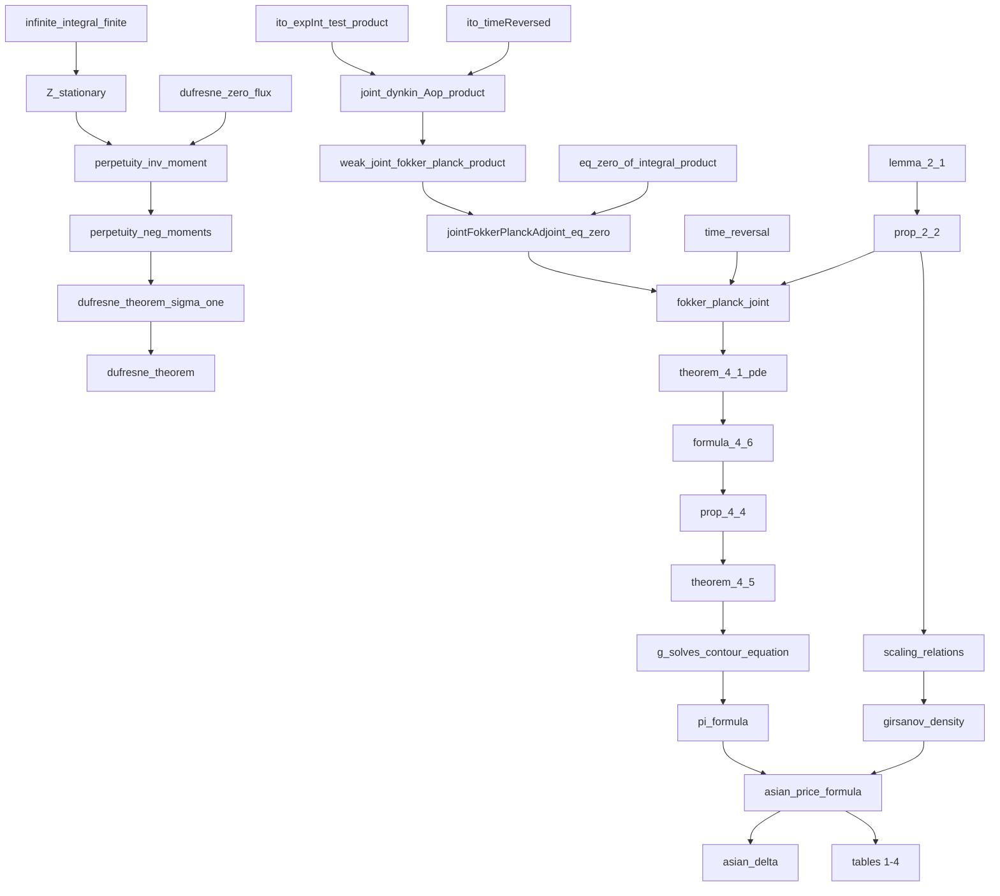

# Proof holes (Lyasoff 2016)

Inventory of paper-facing Lean holes, ordered **prove-first**.

**Updated:** 2026-11-18T02:48:57Z
**Holes:** 0 open+blocked · 0 open · 0 blocked · 38 done.

**Live board:** [`holes.html`](holes.html) + [`holes-graph.json`](holes-graph.json).

```bash
python3 scripts/build_holes.py
python3 -m http.server 8765   # then open http://localhost:8765/holes.html
```

## Open now (Layer 0)

_None — every remaining hole is blocked or done._

## By section

### §1 — 0 hole(s)

| Status | Id | Label | File |
|---|---|---|---|
| done | `time_reversal` | §1 time rev | `Lyasoff2016/Setting.lean:79` |

### §2 — 0 hole(s)

| Status | Id | Label | File |
|---|---|---|---|
| done | `lemma_2_1` | Lem 2.1 | `Lyasoff2016/Auxiliary.lean:57` |
| done | `prop_2_2` | Prop 2.2 | `Lyasoff2016/Auxiliary.lean:64` |
| done | `scaling_relations` | Scaling | `Lyasoff2016/Auxiliary.lean:184` |
| done | `girsanov_density` | Girsanov (2.2) | `Lyasoff2016/Auxiliary.lean:219` |

### §3 — 0 hole(s)

| Status | Id | Label | File |
|---|---|---|---|
| done | `infinite_integral_finite` | ∫₀^∞ finite | `Lyasoff2016/FokkerPlanck.lean:97` |
| done | `Z_stationary` | Z stationary | `Lyasoff2016/FokkerPlanck.lean:318` |
| done | `dufresne_zero_flux` | Zero-flux ODE | `Lyasoff2016/Dufresne.lean:216` |
| done | `perpetuity_inv_moment` | E[A⁻¹]=−ν | `Lyasoff2016/FokkerPlanck.lean:782` |
| done | `perpetuity_neg_moments` | E[A⁻ⁿ] | `Lyasoff2016/FokkerPlanck.lean:2318` |
| done | `dufresne_theorem_sigma_one` | Dufresne σ=1 | `Lyasoff2016/FokkerPlanck.lean:2390` |
| done | `dufresne_theorem` | Dufresne thm | `Lyasoff2016/FokkerPlanck.lean:2480` |
| done | `ito_expInt_test_product` | Ito (3.4a) | `Lyasoff2016/JointFokkerPlanckIto.lean:378` |
| done | `ito_timeReversed_expInt_test_product` | Ito (3.4b) | `Lyasoff2016/JointFokkerPlanckIto.lean:886` |
| done | `joint_dynkin_Aop_product` | Dynkin (3.5) | `Lyasoff2016/FokkerPlanck.lean:2541` |
| done | `weak_joint_fokker_planck_product` | Weak FP product | `Lyasoff2016/FokkerPlanck.lean:3155` |
| done | `eq_zero_of_integral_product_eq_zero` | Product fund. lemma | `Lyasoff2016/JointFokkerPlanckHelpers.lean:70` |
| done | `jointFokkerPlanckAdjoint_eq_zero` | Adjoint = 0 | `Lyasoff2016/FokkerPlanck.lean:3326` |
| done | `fokker_planck_joint` | FP (3.6b) | `Lyasoff2016/FokkerPlanck.lean:3346` |
| done | `remark_3_2` | Rem 3.2 | `Lyasoff2016/FokkerPlanck.lean:3402` |

### §4 — 0 hole(s)

| Status | Id | Label | File |
|---|---|---|---|
| done | `theorem_4_1_pde` | Thm 4.1 PDE | `Lyasoff2016/Foliation.lean:28` |
| done | `theorem_4_1_striking` | Thm 4.1 (4.4) | `Lyasoff2016/Foliation.lean:43` |
| done | `formula_4_6` | (4.6) | `Lyasoff2016/Foliation.lean:85` |
| done | `prop_4_4` | Prop 4.4 | `Lyasoff2016/Foliation.lean:304` |
| done | `theorem_4_5` | Thm 4.5 | `Lyasoff2016/Foliation.lean:351` |

### §5 — 0 hole(s)

| Status | Id | Label | File |
|---|---|---|---|
| done | `g_solves_contour_equation` | g contour eq | `Lyasoff2016/ContourEq.lean:138` |
| done | `remark_5_1` | Rem 5.1 | `Lyasoff2016/PiFormulaLaplace.lean:181` |
| done | `pi_formula` | π / π/2 | `Lyasoff2016/IntegralReps.lean:43` |
| done | `yor_formula` | Yor formula | `Lyasoff2016/IntegralReps.lean:33` |

### §6 — 0 hole(s)

| Status | Id | Label | File |
|---|---|---|---|
| done | `S_zero` | S_{0,p} | `Lyasoff2016/Sfun.lean:205` |
| done | `S_closed_form` | S_{k,p} | `Lyasoff2016/Sfun.lean:210` |
| done | `benchmark_k_zero` | k=0 benchmark | `Lyasoff2016/Asian.lean:31` |
| done | `asian_price_formula` | Asian price | `Lyasoff2016/Asian.lean:139` |
| done | `asian_delta` | Asian delta | `Lyasoff2016/Asian.lean:306` |
| done | `table1_asian_enclosure` | Table 1 | `Lyasoff2016/TableClaim.lean:71` |
| done | `table2_asian_enclosure` | Table 2 | `Lyasoff2016/TableClaim.lean:79` |
| done | `table3_asian_enclosure` | Table 3 | `Lyasoff2016/TableClaim.lean:87` |
| done | `table4_asian_enclosure` | Table 4 | `Lyasoff2016/TableClaim.lean:95` |

## Dependency sketch



