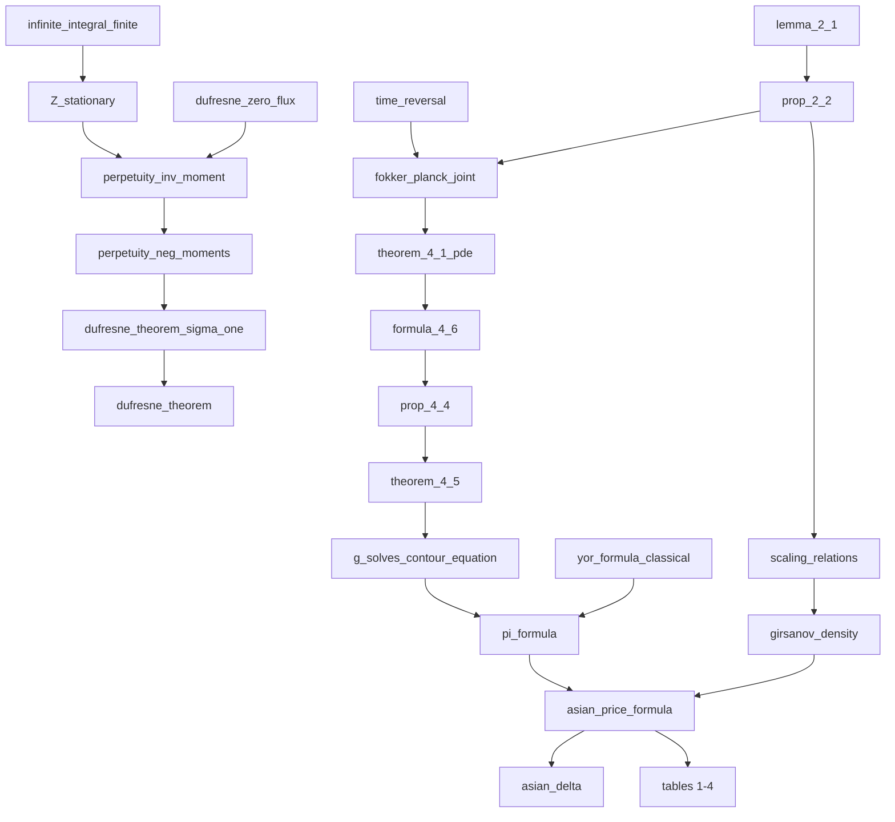

# Proof holes (Lyasoff 2016)

Inventory of paper-facing Lean holes, ordered **prove-first**.

**Updated:** 2026-11-17T03:49:27Z
**Holes:** 9 open+blocked · 2 open · 7 blocked · 24 done.

**Live board:** [`holes.html`](holes.html) + [`holes-graph.json`](holes-graph.json).

```bash
python3 scripts/build_holes.py
python3 -m http.server 8765   # then open http://localhost:8765/holes.html
```

## Open now (Layer 0)

| Id | Label | File |
|---|---|---|
| `prop_2_2` | Prop 2.2 | `Lyasoff2016/Auxiliary.lean:58` |
| `g_solves_contour_equation` | g contour eq | `Lyasoff2016/IntegralReps.lean:72` |

## By section

### §1 — 0 hole(s)

| Status | Id | Label | File |
|---|---|---|---|
| done | `time_reversal` | §1 time rev | `Lyasoff2016/Setting.lean:85` |

### §2 — 1 hole(s)

| Status | Id | Label | File |
|---|---|---|---|
| done | `lemma_2_1` | Lem 2.1 | `Lyasoff2016/Auxiliary.lean:51` |
| open | `prop_2_2` | Prop 2.2 | `Lyasoff2016/Auxiliary.lean:58` |
| done | `scaling_relations` | Scaling | `Lyasoff2016/Auxiliary.lean:178` |
| done | `girsanov_density` | Girsanov (2.2) | `Lyasoff2016/Auxiliary.lean:213` |

### §3 — 0 hole(s)

| Status | Id | Label | File |
|---|---|---|---|
| done | `infinite_integral_finite` | ∫₀^∞ finite | `Lyasoff2016/FokkerPlanck.lean:88` |
| done | `Z_stationary` | Z stationary | `Lyasoff2016/FokkerPlanck.lean:430` |
| done | `dufresne_zero_flux` | Zero-flux ODE | `Lyasoff2016/FokkerPlanck.lean:446` |
| done | `perpetuity_inv_moment` | E[A⁻¹]=−ν | `Lyasoff2016/FokkerPlanck.lean:1183` |
| done | `perpetuity_neg_moments` | E[A⁻ⁿ] | `Lyasoff2016/FokkerPlanck.lean:2750` |
| done | `dufresne_theorem_sigma_one` | Dufresne σ=1 | `Lyasoff2016/FokkerPlanck.lean:2822` |
| done | `dufresne_theorem` | Dufresne thm | `Lyasoff2016/FokkerPlanck.lean:2912` |
| done | `fokker_planck_joint` | FP (3.6b) | `Lyasoff2016/FokkerPlanck.lean:3082` |
| done | `remark_3_2` | Rem 3.2 | `Lyasoff2016/FokkerPlanck.lean:3136` |

### §4 — 0 hole(s)

| Status | Id | Label | File |
|---|---|---|---|
| done | `theorem_4_1_pde` | Thm 4.1 PDE | `Lyasoff2016/Foliation.lean:55` |
| done | `theorem_4_1_striking` | Thm 4.1 (4.4) | `Lyasoff2016/Foliation.lean:70` |
| done | `formula_4_6` | (4.6) | `Lyasoff2016/Foliation.lean:139` |
| done | `prop_4_4` | Prop 4.4 | `Lyasoff2016/Foliation.lean:358` |
| done | `theorem_4_5` | Thm 4.5 | `Lyasoff2016/Foliation.lean:405` |

### §5 — 2 hole(s)

| Status | Id | Label | File |
|---|---|---|---|
| open | `g_solves_contour_equation` | g contour eq | `Lyasoff2016/IntegralReps.lean:72` |
| done | `yor_formula_classical` | Yor classical | `Lyasoff2016/IntegralReps.lean:198` |
| done | `remark_5_1` | Rem 5.1 | `Lyasoff2016/IntegralReps.lean:189` |
| blocked | `pi_formula` | π / π/2 | `Lyasoff2016/IntegralReps.lean:228` |
| done | `yor_formula` | Yor via Rem 5.1 | `Lyasoff2016/IntegralReps.lean:205` |

### §6 — 6 hole(s)

| Status | Id | Label | File |
|---|---|---|---|
| done | `S_zero` | S_{0,p} | `Lyasoff2016/Asian.lean:87` |
| done | `S_closed_form` | S_{k,p} | `Lyasoff2016/Asian.lean:161` |
| done | `benchmark_k_zero` | k=0 benchmark | `Lyasoff2016/Asian.lean:326` |
| blocked | `asian_price_formula` | Asian price | `Lyasoff2016/Asian.lean:381` |
| blocked | `asian_delta` | Asian delta | `Lyasoff2016/Asian.lean:481` |
| blocked | `table1_asian_enclosure` | Table 1 | `Lyasoff2016/Tables.lean:127` |
| blocked | `table2_asian_enclosure` | Table 2 | `Lyasoff2016/Tables.lean:136` |
| blocked | `table3_asian_enclosure` | Table 3 | `Lyasoff2016/Tables.lean:143` |
| blocked | `table4_asian_enclosure` | Table 4 | `Lyasoff2016/Tables.lean:150` |

## Dependency sketch



