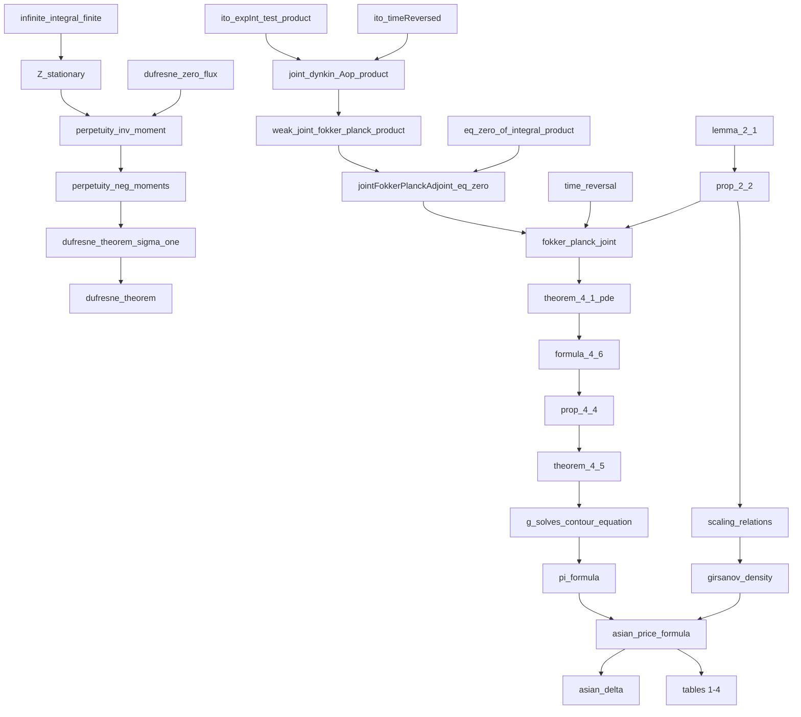

# Proof holes (Lyasoff 2016)

Inventory of paper-facing Lean holes, ordered **prove-first**.

**Updated:** 2026-11-18T13:56:16Z
**Holes:** 8 open+blocked · 4 open · 4 blocked · 40 done.

**Live board:** [`holes.html`](holes.html) (graph embedded; open the file directly).

**Completed proof writeup:** [`Actions.md`](Actions.md) (paper-facing narrative).

```bash
python3 scripts/build_holes.py   # refreshes HOLES.md, holes-graph.json, embeds into holes.html
```

## Open now (Layer 0)

| Id | Label | File |
|---|---|---|
| `table1_asian_enclosure_classical` | Table 1 num. | `Lyasoff2016/TableClassical.lean:67` |
| `table2_asian_enclosure_classical` | Table 2 num. | `Lyasoff2016/TableClassical.lean:77` |
| `table3_asian_enclosure_classical` | Table 3 num. | `Lyasoff2016/TableClassical.lean:87` |
| `table4_asian_enclosure_classical` | Table 4 num. | `Lyasoff2016/TableClassical.lean:97` |

## By section

### §1 — 0 hole(s)

| Status | Id | Label | File |
|---|---|---|---|
| done | `time_reversal` | §1 time rev | `Lyasoff2016/Setting.lean:79` |

### §2 — 0 hole(s)

| Status | Id | Label | File |
|---|---|---|---|
| done | `lemma_2_1` | Lem 2.1 | `Lyasoff2016/Auxiliary.lean:58` |
| done | `prop_2_2` | Prop 2.2 | `Lyasoff2016/Auxiliary.lean:65` |
| done | `scaling_relations` | Scaling | `Lyasoff2016/Auxiliary.lean:185` |
| done | `girsanov_density` | Girsanov (2.2) | `Lyasoff2016/Auxiliary.lean:220` |

### §3 — 0 hole(s)

| Status | Id | Label | File |
|---|---|---|---|
| done | `infinite_integral_finite` | ∫₀^∞ finite | `Lyasoff2016/FokkerPlanck.lean:98` |
| done | `Z_stationary` | Z stationary | `Lyasoff2016/FokkerPlanck.lean:319` |
| done | `dufresne_zero_flux` | Zero-flux ODE | `Lyasoff2016/Dufresne.lean:217` |
| done | `perpetuity_inv_moment` | E[A⁻¹]=−ν | `Lyasoff2016/FokkerPlanck.lean:783` |
| done | `perpetuity_neg_moments` | E[A⁻ⁿ] | `Lyasoff2016/FokkerPlanck.lean:2319` |
| done | `dufresne_theorem_sigma_one` | Dufresne σ=1 | `Lyasoff2016/FokkerPlanck.lean:2391` |
| done | `dufresne_theorem` | Dufresne thm | `Lyasoff2016/FokkerPlanck.lean:2481` |
| done | `ito_expInt_test_product` | Ito (3.4a) | `Lyasoff2016/JointFokkerPlanckIto.lean:379` |
| done | `ito_timeReversed_expInt_test_product` | Ito (3.4b) | `Lyasoff2016/JointFokkerPlanckIto.lean:887` |
| done | `joint_dynkin_Aop_product` | Dynkin (3.5) | `Lyasoff2016/FokkerPlanck.lean:2542` |
| done | `weak_joint_fokker_planck_product` | Weak FP product | `Lyasoff2016/FokkerPlanck.lean:3156` |
| done | `eq_zero_of_integral_product_eq_zero` | Product fund. lemma | `Lyasoff2016/JointFokkerPlanckHelpers.lean:71` |
| done | `jointFokkerPlanckAdjoint_eq_zero` | Adjoint = 0 | `Lyasoff2016/FokkerPlanck.lean:3327` |
| done | `fokker_planck_joint` | FP (3.6b) | `Lyasoff2016/FokkerPlanck.lean:3347` |
| done | `remark_3_2` | Rem 3.2 | `Lyasoff2016/FokkerPlanck.lean:3403` |

### §4 — 0 hole(s)

| Status | Id | Label | File |
|---|---|---|---|
| done | `theorem_4_1_pde` | Thm 4.1 PDE (cond.) | `Lyasoff2016/Foliation.lean:34` |
| done | `theorem_4_1_striking` | Thm 4.1 (4.4) (cond.) | `Lyasoff2016/Foliation.lean:53` |
| done | `formula_4_6` | (4.6) (cond.) | `Lyasoff2016/Foliation.lean:97` |
| done | `prop_4_4` | Prop 4.4 | `Lyasoff2016/Foliation.lean:316` |
| done | `theorem_4_5` | Thm 4.5 (cond.) | `Lyasoff2016/Foliation.lean:365` |
| done | `cond_density_satisfies_theorem_41_pde` | Cond dens. PDE | `Lyasoff2016/Foliation.lean:437` |
| done | `cond_density_satisfies_striking` | Cond dens. (4.4) | `Lyasoff2016/Foliation.lean:539` |
| done | `cond_density_satisfies_foliation_ode` | Cond dens. ODE | `Lyasoff2016/Foliation.lean:445` |
| done | `cond_density_satisfies_laplace_inputs` | Cond dens. Laplace | `Lyasoff2016/Foliation.lean:510` |

### §5 — 0 hole(s)

| Status | Id | Label | File |
|---|---|---|---|
| done | `g_solves_contour_equation` | g contour eq | `Lyasoff2016/ContourEq.lean:139` |
| done | `remark_5_1` | Rem 5.1 | `Lyasoff2016/PiFormulaLaplace.lean:182` |
| done | `pi_formula` | π / π/2 | `Lyasoff2016/IntegralReps.lean:44` |
| done | `yor_formula` | Yor formula | `Lyasoff2016/IntegralReps.lean:34` |

### §6 — 8 hole(s)

| Status | Id | Label | File |
|---|---|---|---|
| done | `S_zero` | S_{0,p} | `Lyasoff2016/Sfun.lean:206` |
| done | `S_closed_form` | S_{k,p} | `Lyasoff2016/Sfun.lean:211` |
| done | `benchmark_k_zero` | k=0 benchmark | `Lyasoff2016/Asian.lean:32` |
| done | `asian_price_formula` | Asian price | `Lyasoff2016/Asian.lean:140` |
| done | `asian_delta` | Asian delta | `Lyasoff2016/Asian.lean:493` |
| done | `SfunC.hasDerivAt` | ∂_k SfunC | `Lyasoff2016/SfunCDeriv.lean:100` |
| done | `hasDerivAt_integral_Re_Ffun` | ∂_k ∬ Re F | `Lyasoff2016/Asian.lean:300` |
| blocked | `table1_asian_enclosure` | Table 1 | `Lyasoff2016/TableClaim.lean:77` |
| blocked | `table2_asian_enclosure` | Table 2 | `Lyasoff2016/TableClaim.lean:85` |
| blocked | `table3_asian_enclosure` | Table 3 | `Lyasoff2016/TableClaim.lean:93` |
| blocked | `table4_asian_enclosure` | Table 4 | `Lyasoff2016/TableClaim.lean:101` |
| open | `table1_asian_enclosure_classical` | Table 1 num. | `Lyasoff2016/TableClassical.lean:67` |
| open | `table2_asian_enclosure_classical` | Table 2 num. | `Lyasoff2016/TableClassical.lean:77` |
| open | `table3_asian_enclosure_classical` | Table 3 num. | `Lyasoff2016/TableClassical.lean:87` |
| open | `table4_asian_enclosure_classical` | Table 4 num. | `Lyasoff2016/TableClassical.lean:97` |

## Dependency sketch



